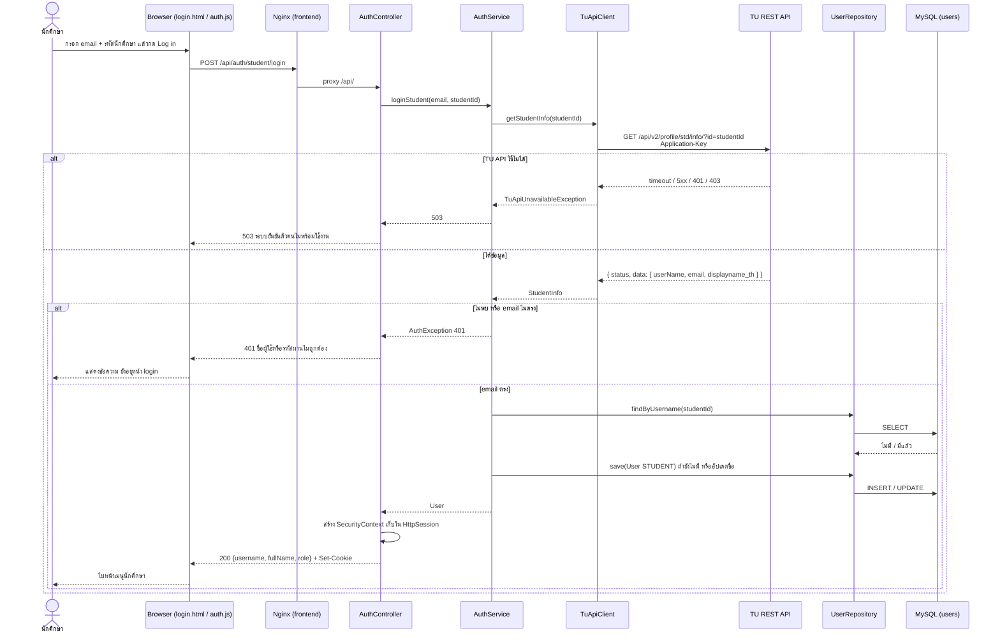
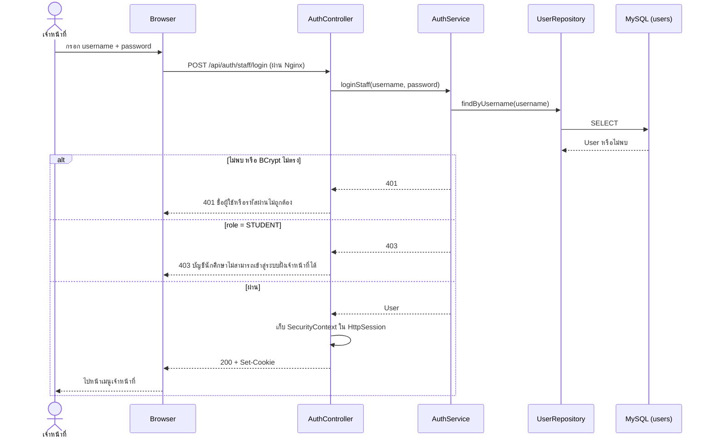
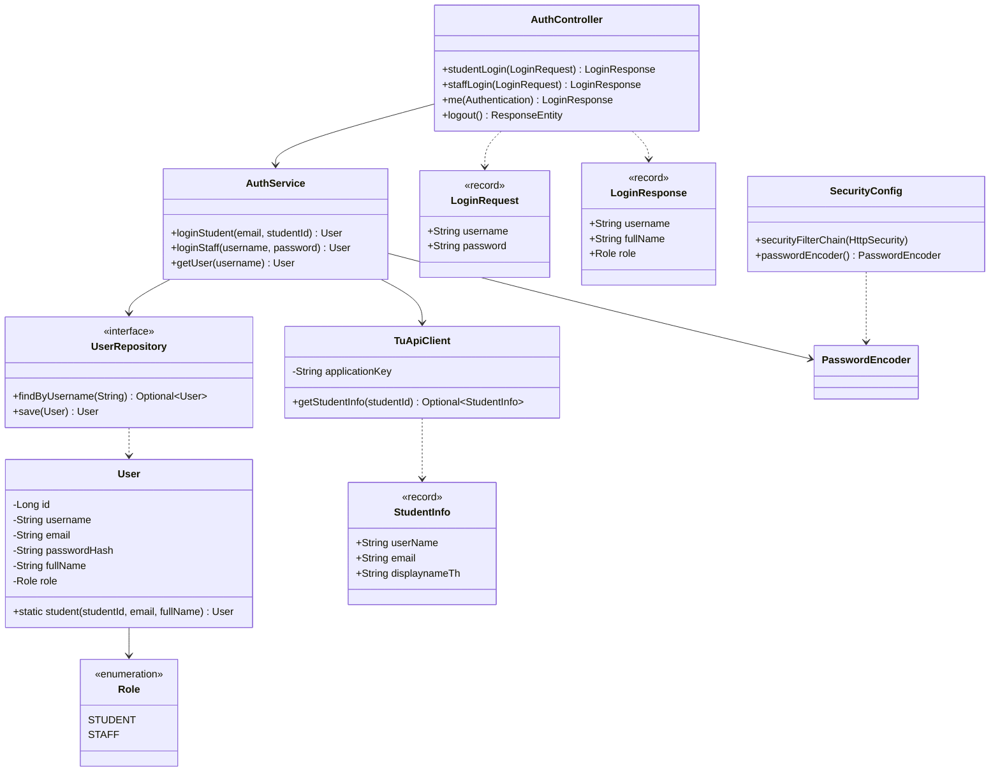

# ออกแบบระบบ Login (Task27 · US1-A, US1-B)

## 1. วิธี login ที่ทีมเลือก

| ผู้ใช้ | ตรวจตัวตนด้วย | username | password |
|---|---|---|---|
| นักศึกษา (US1-A) | **TU API** `GET /api/v2/profile/std/info/?id=` | `email` ของนักศึกษา เช่น `xxx@dome.tu.ac.th` | `userName` คือรหัสนักศึกษา 10 หลัก |
| เจ้าหน้าที่หอพัก (US1-B) | ตาราง `users` ใน MySQL + BCrypt | username ที่ seed ไว้ | รหัสผ่านที่เก็บเป็น BCrypt hash |

- login สำเร็จแล้วเก็บสถานะด้วย **session ของ Spring Security** (cookie `JSESSIONID`) ไม่ใช้ JWT เพราะหน้าเว็บกับ API อยู่หลัง Nginx ตัวเดียวกัน
- นักศึกษา login ผ่านเมื่อ TU API ตอบ `status: true` และ `data.email` ตรงกับ email ที่กรอก (ไม่สนตัวพิมพ์เล็ก/ใหญ่)
- login ครั้งแรกให้บันทึกนักศึกษาลงตาราง `users` (ไม่มีรหัสผ่าน) เพื่อใช้ผูกกับคำร้องและแสดงชื่อในหน้าเว็บ
- `Application-Key` ของ TU API เก็บใน `.env` เป็น `TU_API_KEY` และใช้เฉพาะฝั่ง backend ห้ามอยู่ใน JavaScript ของหน้าเว็บ

### ข้อจำกัดที่ต้องรู้
- API นี้ไม่ได้ตรวจรหัสผ่าน TU จริง ใครรู้ email กับรหัสนักศึกษาของคนอื่นก็ login แทนได้ (ยอมรับได้สำหรับโปรเจกต์ในวิชา)
- ใช้ได้กับนักศึกษาเท่านั้น เจ้าหน้าที่จึงยังใช้บัญชีในฐานข้อมูล
- เครื่องที่ demo ต้องต่ออินเทอร์เน็ตได้ ถ้า TU API ใช้ไม่ได้ ระบบตอบ 503 และหน้าเว็บแสดงข้อความแจ้ง
- TU API จำกัด 3,000 requests ต่อชั่วโมงต่อ key

## 2. API spec

ทุก response เป็น JSON และ error ใช้รูปแบบ `{"message": "..."}` เหมือน API คำร้องเดิม

### `POST /api/auth/student/login`
```json
{ "username": "somchai.jai@dome.tu.ac.th", "password": "6609999999" }
```
| Status | เมื่อไร | Body |
|---|---|---|
| 200 | email ตรงกับข้อมูลจาก TU API | `{"username":"6609999999","fullName":"สมชาย ใจดี","role":"STUDENT"}` + `Set-Cookie: JSESSIONID` |
| 400 | ช่องว่าง | `{"message":"กรุณากรอกชื่อผู้ใช้และรหัสผ่าน"}` |
| 401 | รหัสนักศึกษาไม่ใช่ตัวเลข 10 หลัก, TU ไม่พบรหัสนี้ หรือ email ไม่ตรง | `{"message":"ชื่อผู้ใช้หรือรหัสผ่านไม่ถูกต้อง"}` |
| 503 | เรียก TU API ไม่สำเร็จ (timeout, 5xx, key ผิด) | `{"message":"ระบบยืนยันตัวตนของมหาวิทยาลัยไม่พร้อมใช้งาน กรุณาลองใหม่"}` |

### `POST /api/auth/staff/login`
```json
{ "username": "staff01", "password": "********" }
```
| Status | เมื่อไร | Body |
|---|---|---|
| 200 | รหัสผ่านถูกและ role เป็น STAFF | `{"username":"staff01","fullName":"...","role":"STAFF"}` + `Set-Cookie: JSESSIONID` |
| 400 | ช่องว่าง | `{"message":"กรุณากรอกชื่อผู้ใช้และรหัสผ่าน"}` |
| 401 | ไม่พบผู้ใช้หรือรหัสผ่านผิด | `{"message":"ชื่อผู้ใช้หรือรหัสผ่านไม่ถูกต้อง"}` |
| 403 | บัญชีนี้เป็นนักศึกษา (US1-B TC02) | `{"message":"บัญชีนักศึกษาไม่สามารถเข้าสู่ระบบฝั่งเจ้าหน้าที่ได้"}` |

### `GET /api/auth/me`
ทุกหน้าเรียกตอนเปิด เพื่อตรวจว่ายัง login อยู่และเป็น role อะไร
| Status | Body |
|---|---|
| 200 | `{"username":"6609999999","fullName":"สมชาย ใจดี","role":"STUDENT"}` |
| 401 | ยังไม่ได้ login หรือ session หมดอายุ → หน้าเว็บพากลับหน้า login |

### `POST /api/auth/logout`
| Status | Body |
|---|---|
| 204 | ไม่มี body, ลบ session |

### สิทธิ์ของ API อื่น
| API | ต้องเป็น |
|---|---|
| `POST /api/repair-requests`, `GET /api/repair-requests/mine`, `PUT /api/repair-requests/{id}` | STUDENT |
| `GET /api/repair-requests`, `GET /api/repair-requests/{id}`, `PATCH .../accept`, `PATCH .../status` | STAFF |

ไม่ได้ login ได้ 401 และ role ไม่ตรงได้ 403 (`/mine`, `PUT` และ `/status` จะมาจาก Task32, Task36 และ Task38)

## 3. Sequence Diagram

### นักศึกษา login (US1-A)


### เจ้าหน้าที่ login (US1-B)


## 4. Class Diagram



## 5. ตาราง `users`

| คอลัมน์ | ชนิด | หมายเหตุ |
|---|---|---|
| `id` | BIGINT PK AUTO_INCREMENT | |
| `username` | VARCHAR(50) UNIQUE NOT NULL | นักศึกษาใช้รหัสนักศึกษา |
| `email` | VARCHAR(100) NULL | จาก TU API |
| `password_hash` | VARCHAR(100) **NULL** | มีเฉพาะเจ้าหน้าที่ |
| `full_name` | VARCHAR(150) NOT NULL | นักศึกษาใช้ `displayname_th` |
| `role` | VARCHAR(20) NOT NULL | `STUDENT` / `STAFF` |

ไฟล์ `database/init/02-users.sql` สร้างตารางนี้และ seed บัญชีเจ้าหน้าที่อย่างน้อย 1 บัญชี

## 6. สิ่งที่ต้องแก้ในโค้ดปัจจุบัน (Task28)
- `backend/pom.xml` ยังไม่มี `spring-boot-starter-security` และ `spring-boot-starter-validation` ทำให้ `develop` build ไม่ผ่าน
- `User.passwordHash` ต้องเปลี่ยนเป็น nullable และเพิ่ม `email`
- แยก `AuthService.login` เป็น `loginStudent` (TU API) กับ `loginStaff` (BCrypt)
- เพิ่ม `TuApiClient`, `SecurityConfig` และ `database/init/02-users.sql`
- เพิ่ม `TU_API_KEY` ใน `.env.example` และ `compose.yaml`
